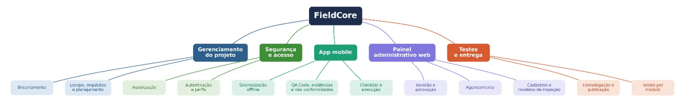

# Gestão do Projeto — FieldOps

Artefatos de gerenciamento do projeto (base PMBOK), mantidos diretamente neste repositório — diferente da especificação em [`../NOTION/`](../NOTION/README.md), que é exportada do Notion.

## Artefatos

| Artefato | Arquivo | O que é | Quando atualizar |
|---|---|---|---|
| Termo de Abertura (TAP) | [TAP.md](TAP.md) | Escopo, objetivos, premissas, riscos, stakeholders e aprovações do projeto | Só com aprovação do sponsor — mudança de escopo exige revisão de cronograma e prazo |
| Cronograma | [CRONOGRAMA.md](CRONOGRAMA.md) | 89 atividades em 11 fases, dependências (FS/SS/FF), caminho crítico e 11 marcos | Continuamente (processo 6.7 — controlar o cronograma): datas reais × planejadas, desvios e mudanças de linha de base |
| Planejamento de sprints | [SPRINT_PLANNING.md](SPRINT_PLANNING.md) | PBIs do Notion (doc. 15) no GitHub: estimativas, dependências, cadência weekly/daily e ordem de corte | A cada refinamento e weekly (sprints, velocidade, estado real) |
| Convenção de branches/commits | [BRANCH_COMMIT_CONVENTION.md](BRANCH_COMMIT_CONVENTION.md) | Hierarquia PBI → filho → tarefa em issues, branches, commits e PRs | Quando a convenção mudar (renomear issues abertas na weekly seguinte) |
| Atualizar clone após rename | [REPO_RENAME_GUIDE.md](REPO_RENAME_GUIDE.md) | Como atualizar o `origin` e renomear a pasta local (`api-java`, `web-react`, `mobile-react`, `docs`) | Após o rename na org; cada pessoa com clone antigo |
| Templates GitHub (issue/PR) | [`.github/ISSUE_TEMPLATE/`](../.github/ISSUE_TEMPLATE/) · [PR template](../.github/pull_request_template.md) | Formulários ao criar issue (PBI / filho-tarefa) e corpo padrão de PR | Quando o padrão de descrição mudar |
| EAP | [EAP.jpeg](EAP.jpeg) | Estrutura Analítica do Projeto que originou o cronograma | Quando o escopo for decomposto de forma diferente |

## Resumo executivo

- **Início:** 24/08/2026 · **Prazo final:** 30/11/2026 · **Encerramento previsto:** 27/11/2026 (margem de apenas 1 dia útil)
- **Estratégia de compressão:** backend, web e mobile em trilhas paralelas após a infraestrutura base; front e mobile evoluem contra mocks até a Fase 7 (Integração)
- **Caminho crítico:** Fase 3 (Infra) → Fase 4 (Backend) → Fase 7 (Integração) → Fase 8 (Testes) → Fase 9 (Homologação) → Fase 10 (Implantação). Qualquer atraso nele é risco imediato ao prazo.

Marcos completos e tabela de atividades: [CRONOGRAMA.md](CRONOGRAMA.md#4-marcos-do-projeto-resumo).

## O que ainda falta nesta pasta (próximos artefatos sugeridos)

Em ordem de valor para o projeto — crie o arquivo só quando houver conteúdo real, não como placeholder vazio:

1. **`RISCOS.md`** — registro de riscos vivo. O TAP já lista 3 riscos principais (atraso, contrato de API inconsistente, perda/duplicidade na sincronização offline); falta probabilidade, impacto, dono e plano de resposta para cada um.
2. **`STATUS.md`** (ou ata semanal) — acompanhamento por sprint: previsto × realizado, desvios do cronograma e decisões da semana. É a evidência do controle do cronograma (6.7).
3. **Fonte editável da EAP** — hoje a EAP é só uma imagem (`EAP.jpeg`). Guarde também a fonte (Mermaid, draw.io, planilha) para poder alterar sem redesenhar.
4. **Plano de comunicação / matriz de responsabilidades (RACI)** — quem aprova o quê entre GP, PO, devs e sponsor.

## Convenções

- Datas sempre em `dd/mm/aaaa` e prazos em dias úteis, como no cronograma.
- Responsáveis por papel (GP, PO, ARQ, Dev Backend…) até o time fechar nomes por atividade — ver observação no [Cronograma](CRONOGRAMA.md).
- Mudou escopo, prazo ou marco? Atualize TAP/cronograma **e** registre em [`../DECISIONS/`](../DECISIONS/README.md).
